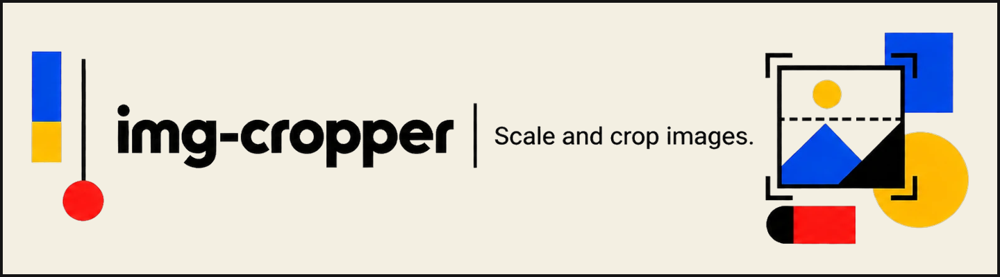
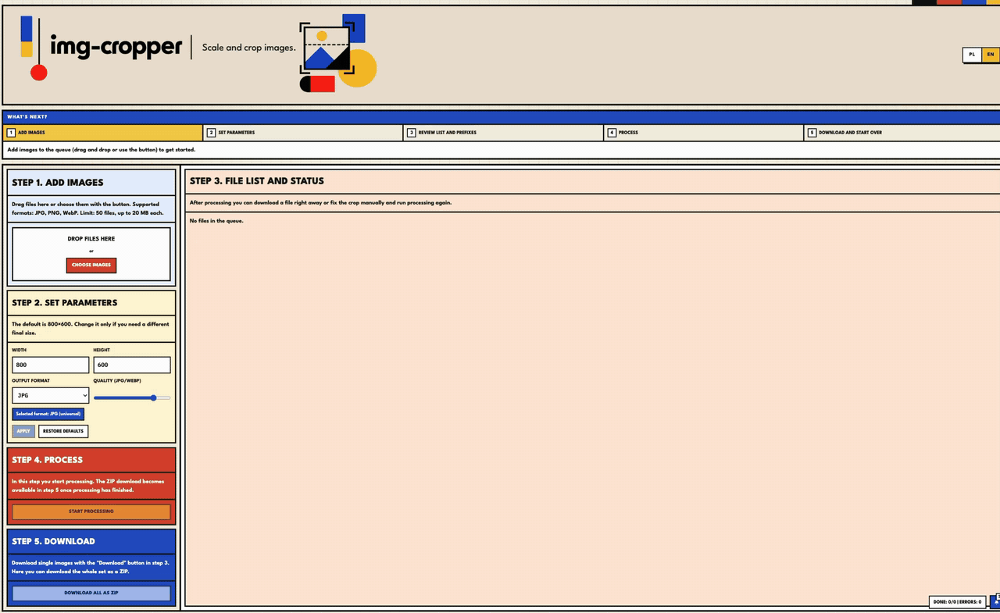

<p align="center">
  
</p>

# img-cropper

[](https://github.com/JakubPioro/img-cropper/actions/workflows/ci.yml)

Batch resize and crop images in the browser. Nothing is uploaded: every image is decoded, cropped and encoded on your device.

**Live demo:** [jakubpioro.github.io/img-cropper](https://jakubpioro.github.io/img-cropper/)



## Why I built it

My mum is a teacher, and her school asks staff to submit photos as 800×600 JPGs (600×800 for portrait shots) with a fixed file-naming convention. Image editors are not her thing, so every batch landed on my desk: about 20 minutes of resizing, cropping and renaming each time.

Instead of teaching her a graphics program, I built a tool she can use on her own. The same job now takes a few seconds. The app is designed for non-technical users first:

- **The defaults match the school's requirements**, so a typical batch needs no settings at all.
- **Portrait photos keep their orientation**: the target size flips to 600×800 instead of squeezing a portrait into a landscape frame.
- **A numbered, step-by-step flow** with a hint for the next action, instead of a toolbar of tools to figure out.
- **Batch renaming with a numbered prefix**, to follow the naming convention without renaming files one by one.
- **Plain-language messages** for rejected files and errors, in Polish or English.

## Features

- Add up to 50 JPG, PNG or WebP files (up to 20 MB each) by drag and drop or a file picker.
- Resize every image to one target size (800×600 by default) and export as JPG, PNG or WebP with adjustable quality.
- Automatic centred crop when the source ratio differs from the target.
- Manual crop editor on a canvas: move and resize the selection, rotate the image or the frame.
- Rename files or apply a numbered name prefix to the whole batch.
- Filter the queue by status and download files one by one or as a single ZIP.
- Polish and English UI, switchable at runtime.

## Tech stack

- Vue 3 (Composition API, `<script setup>`), TypeScript
- Pinia, Vue Router
- vue-i18n
- Tailwind CSS
- Canvas API, JSZip, FileSaver
- Vitest, Vue Test Utils
- GitHub Actions, GitHub Pages

## Getting started

CI runs on Node.js 24; use the same version locally.

```bash
npm install
npm run dev
```

| Script               | What it does                         |
| -------------------- | ------------------------------------ |
| `npm run dev`        | Start the Vite dev server            |
| `npm run build`      | Type-check and build for production  |
| `npm run preview`    | Serve the production build locally   |
| `npm run type-check` | Run `vue-tsc` without emitting files |
| `npm test`           | Run unit tests with Vitest           |
| `npm run format`     | Format `src/` with Prettier          |

## Project structure

```
src/
├── components/        UI panels for each step and the crop editor
├── locales/           pl.json and en.json message catalogs
├── stores/            imageStore: queue, settings, processing, notifications
├── utils/
│   ├── imagePipeline.ts   decode → rotate → crop → resize → encode
│   ├── imageMath.ts       target size, centred crop and clamping
│   ├── fileValidation.ts  file count, type and size checks
│   └── zip.ts             ZIP export
├── views/HomeView.vue
└── i18n.ts            locale detection and Polish plural rules
```

## Technical decisions

**Client-side processing.** Images never leave the browser, so there is no server to run and no privacy question for the user. Files are decoded with `createImageBitmap` and `imageOrientation: "from-image"`, so EXIF rotation from phone cameras is respected, with an `` fallback when that API is missing or fails. Bitmaps are closed after use and object URLs are revoked when a file is removed or the queue is cleared, so memory is released.

**One file at a time.** The queue is processed sequentially rather than all at once. A 20 MB photo decodes to a much larger bitmap in memory, and decoding 50 of them in parallel could crash a mobile browser tab.

**Pure logic separated from the UI.** Crop and size calculations live in `imageMath.ts` and file checks in `fileValidation.ts`, with no Vue or DOM dependencies, so they are easy to unit test. The store coordinates them, and components only render state and call actions.

**Translations stored as keys, not text.** Notifications in the store hold a message key and params (for example `filesAdded` with `{ count: 3 }`) and are translated when rendered. Switching the language therefore re-translates notifications that are already on screen. Keys are typed from the message catalog, so a missing key fails type-check. Validation and processing errors follow the same idea: functions return codes (`fileTooLarge`, `imageEncode`) and only the UI turns them into sentences. Polish needs three plural forms (1 plik, 2 pliki, 5 plików), handled by a custom plural rule.

**Pointer events in the crop editor.** The editor uses pointer events with pointer capture, so the same code handles mouse, touch and pen, and a drag is not lost when the pointer leaves the canvas: releasing it outside still ends the drag cleanly.

**CI and deployment.** Every push runs type-check and tests; a push to `main` then builds and deploys to GitHub Pages. Assets are bundled by Vite with content hashes in their file names, so a new deploy is never hidden behind a cached old file.

## Testing

Unit tests cover the image math (target size, centred crop, clamping) and the store (adding and rejecting files, processing, error codes, name prefixes, clearing the queue). The image pipeline and file validation are mocked in store tests, while their constants and error classes stay real.

```bash
npm test
```
